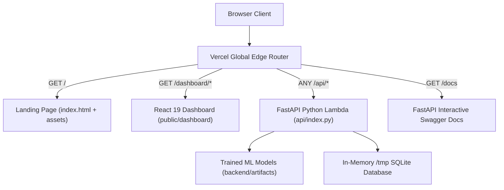

# Vercel Deployment Guide — Crop Yield Prediction System (BT195)

This repository is configured for **Zero-Config, Single-Project Vercel Deployment**. It simultaneously deploys:
1. **The Meadowbell-Inspired Animated Landing Page** at `/`
2. **The Full Multi-Page React 19 Analytics Dashboard** at `/dashboard`
3. **The High-Performance Python FastAPI ML Backend** at `/api/*` and `/docs`

---

## Architecture Overview on Vercel



---

## Method 1: Deploy via Vercel Web Dashboard (Recommended & Easiest)

Since your code is already pushed to GitHub: [kaustub-1410/Cpastone_cropyielding_project](https://github.com/kaustub-1410/Cpastone_cropyielding_project):

1. Go to [https://vercel.com/new](https://vercel.com/new).
2. Log in with your GitHub account.
3. Under **Import Git Repository**, find and select `Cpastone_cropyielding_project`.
4. Vercel will automatically read `vercel.json`:
   - **Framework Preset**: `Other` (auto-detected)
   - **Build Command**: `node vercel-build.js` (auto-detected)
   - **Output Directory**: `public` (auto-detected)
5. Click **Deploy**.
6. In ~1-2 minutes, your deployment URL will be live (e.g. `https://cpastone-cropyielding-project.vercel.app`)!

---

## Method 2: Deploy via Terminal (Vercel CLI)

If you prefer deploying directly from your local PowerShell:

```powershell
# 1. Log into your Vercel account (opens browser authentication)
npx vercel login

# 2. Deploy to Production
npx vercel --prod
```

When prompted:
- **Set up and deploy?**: `Y`
- **Which scope?**: Choose your personal account
- **Link to existing project?**: `N`
- **Project name?**: Press Enter (defaults to `cpastone-cropyielding-project`)
- **Directory located?**: Press Enter (`./`)
- **Override settings?**: Press Enter (`N`, `vercel.json` settings will be used automatically)

---

## Verified Production Endpoints

Once deployed:
| Endpoint | Description |
|---|---|
| `https://<your-project>.vercel.app/` | AgriSense AI Hero Landing Page |
| `https://<your-project>.vercel.app/dashboard` | Full Multi-Page React Analytics Dashboard |
| `https://<your-project>.vercel.app/api/health` | System Health & Diagnostics |
| `https://<your-project>.vercel.app/api/predictions` | Calibrated ML Inference API |
| `https://<your-project>.vercel.app/docs` | Interactive Swagger API Documentation |
